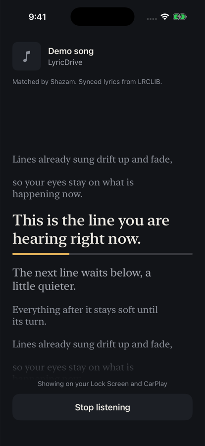
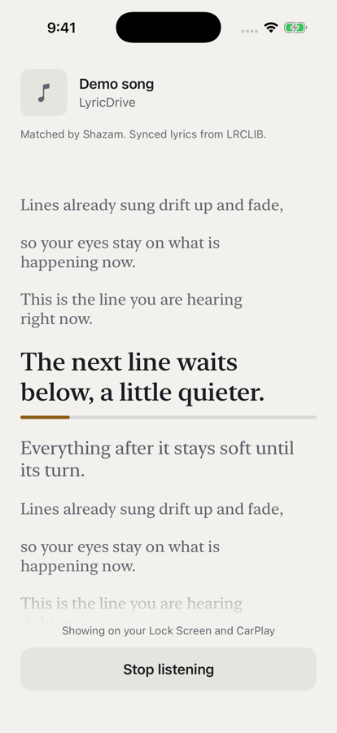
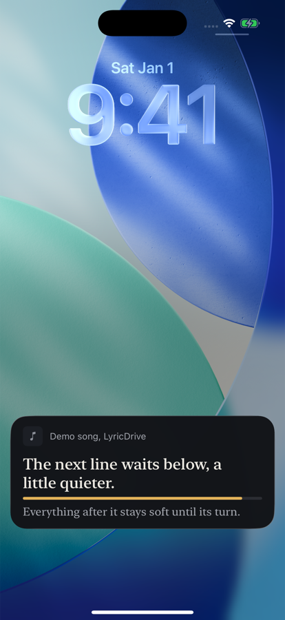
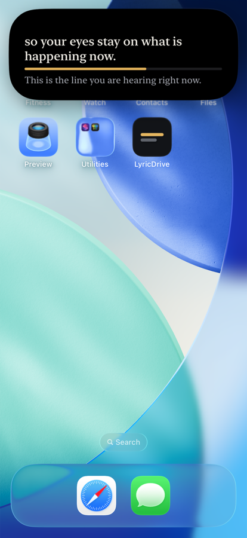

<p align="center">
  
</p>

<h1 align="center">LyricDrive</h1>

<p align="center">
  Synced lyrics for whatever is playing, on your Lock Screen, in the Dynamic Island and in CarPlay.<br>
  A native iOS app built around a Live Activity.
</p>

<p align="center">
  
  &nbsp;
  
  &nbsp;
  
  &nbsp;
  
</p>

<p align="center"><sub>Screenshots use the built-in preview, which plays made-up lines instead of real lyrics.</sub></p>

## Why

Music apps like YouTube Music don't share what they're playing with other apps, and none of them put line-by-line lyrics on the Lock Screen or in the car. LyricDrive listens instead: it recognises the song with Shazam, finds synced lyrics, and keeps the line you're hearing on screen while the phone stays locked.

It was built for one person's drive to work, so it does one thing and tries to do it calmly: the current line in large serif type, the next line quieter underneath, and a thin amber line showing how far through the line you are.

## How it works

```
Music playing (any app)
        │  sound
        ▼
iPhone microphone ──► ShazamKit ──► title, artist, position in the song
                                          │
                                          ▼
                              LRCLIB lookup (cached on device)
                                          │  timed lyrics (LRC)
                                          ▼
                        Line clock: which line is being sung now
                                          │  only when the line changes
                                          ▼
                 Live Activity ──► Lock Screen · Dynamic Island · CarPlay
```

- **Recognition:** [ShazamKit](https://developer.apple.com/shazamkit/) matches the song and reports where you are in it. Matching keeps running, so a skip, a pause or the next song is picked up on its own.
- **Lyrics:** [LRCLIB](https://lrclib.net), a free, open, crowdsourced lyrics database. Synced lyrics are preferred; if the exact names miss, LyricDrive retries with release extras like "(Official Video)" or "feat." removed.
- **Timing:** the app sleeps until the exact moment the next line starts instead of polling, and only updates the Live Activity when the line actually changes. The progress line animates on its own between updates.
- **Staying alive:** the listening session keeps the app running in the background, which is what lets it update the Lock Screen line by line.

## Features

- Line-by-line lyrics on the Lock Screen, in the Dynamic Island and on the CarPlay Dashboard
- Full lyrics in the app, scrolling to keep the current line centered
- Light and dark appearance, following the system setting
- Song artwork from Shazam in the app
- Lyrics cached on device: each song is fetched once
- Clear states for every case: nothing playing, listening, finding lyrics, no lyrics found, lyrics without timing, microphone off, and network or Shazam errors
- Music keeps playing normally while LyricDrive listens: recording doesn't move it to the earpiece
- Uses the iPhone's own microphone when CarPlay is connected, because the car's hands-free microphone filters the music out

## Requirements

- **Xcode 26** or later
- **iOS 26** or later (Live Activities in CarPlay need iOS 26)
- **A paid Apple Developer Program membership.** ShazamKit has to be enabled for the app's App ID, and free Personal Teams can't do that. On a free team, matching fails with `com.apple.ShazamKit 202` (`AMSErrorDomain 306`).
- A real iPhone. The simulator can't hear music for Shazam.

## Getting started

1. **Clone the repo** and open `LyricDrive.xcodeproj`.
2. **Use your own bundle ID and team.** In the project, select each target and, under **Signing & Capabilities**, set your **Team**. Change the bundle IDs to your own; the extension's ID must start with the app's:
   - App: `com.yourname.LyricDrive`
   - Live Activity extension: `com.yourname.LyricDrive.LiveActivity`
3. **Turn on ShazamKit for the App ID.** On [developer.apple.com](https://developer.apple.com/account/resources/identifiers/list), go to **Identifiers**, click **+**, choose **App IDs › App**, enter your app's bundle ID as an **Explicit** ID, and tick **ShazamKit** under **App Services**.
4. **Run the `LyricDrive` scheme** on your iPhone. Don't run `LyricDriveLiveActivity`: Xcode then tries to open it as a Home Screen widget and reports "Failed to show Widget", although the app installs fine.
5. **Allow** the microphone and Live Activities when iOS asks, play a song, and tap **Start listening**.

Debug builds have a **Preview Live Activity (debug)** link on the first screen. It plays made-up lines through the real clock and Live Activity, so you can check the Lock Screen and Dynamic Island without music. You can also start it from the scheme with the launch argument `-demoLiveActivity`.

## Project structure

```
App/
  Listening/   ShazamListener (mic + audio session), MatchedSong
  Lyrics/      LyricsService (LRCLIB + cache), LRCParser, TitleCleaner
  Sync/        LyricClock (line timing), LyricsCoordinator, LiveActivityController
  UI/          RootView (all screens), NowSingingView, AppStyle, Components
Shared/        LyricsActivityAttributes (used by the app and the extension)
Widget/        LyricsLiveActivity (Lock Screen, Dynamic Island, CarPlay), Palette
Config/        Info.plist additions (background audio, widget extension)
docs/          Icon and screenshots for this README
```

## Known limitations

- **Lyrics coverage depends on LRCLIB.** Popular songs are usually there; new releases, niche artists and regional music are more often missing. When a song has no synced lyrics, LyricDrive says so and offers a search by title only.
- **The Live Activity shows a placeholder instead of the cover art.** Sharing the image with the extension needs an App Group, which isn't set up yet.
- **Listening runs continuously** while active, which uses more battery than an occasional check. It's what keeps the app awake to update the Lock Screen. In a car with the phone charging, that's a fair trade.
- **CarPlay hasn't been verified in a car yet.** The layout is built for the CarPlay Dashboard, but it's only been tested on the iPhone and in the simulator.

## Contributing

Issues and pull requests are welcome. Ideas that would help most:

- A paste-and-tap-to-sync screen for songs LRCLIB doesn't have, with an option to publish the timing back to LRCLIB
- Cover art in the Live Activity through an App Group
- A small timing nudge for songs that run slightly early or late

## Credits

- Song recognition by [ShazamKit](https://developer.apple.com/shazamkit/) from Apple.
- Lyrics from [LRCLIB](https://lrclib.net) and the people who contribute to it.
- Lyrics belong to their songwriters and publishers. LyricDrive doesn't include any lyrics; it fetches them at runtime for personal use.

## License

[MIT](LICENSE)
